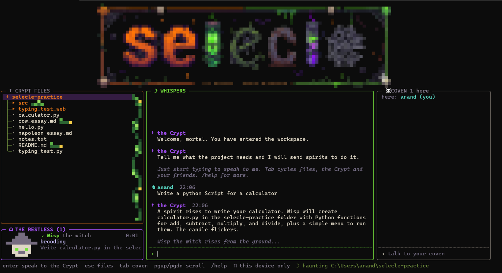
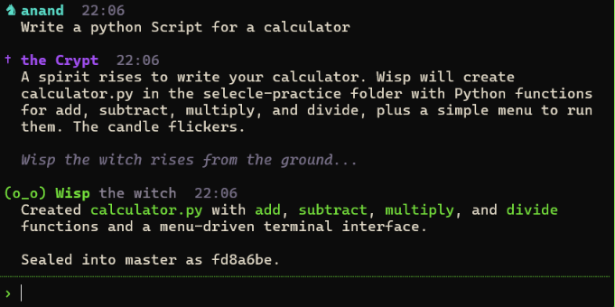
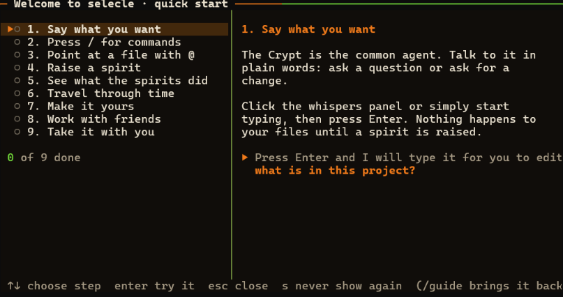
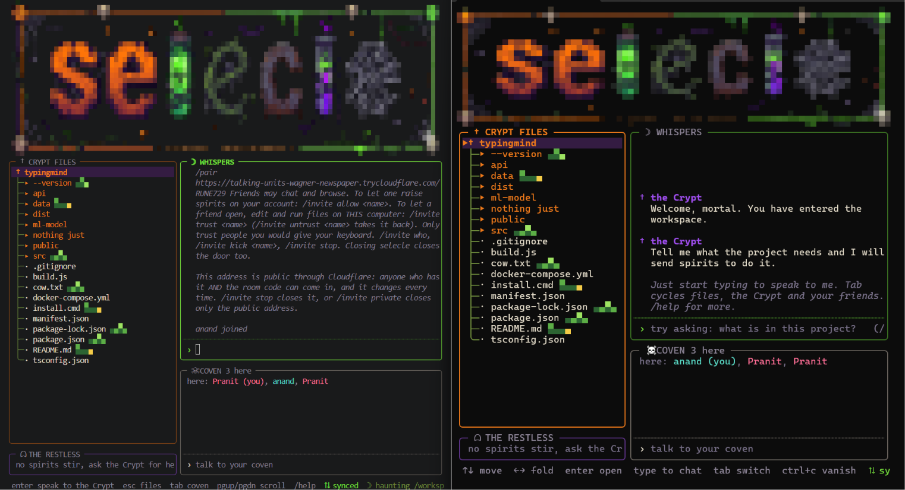
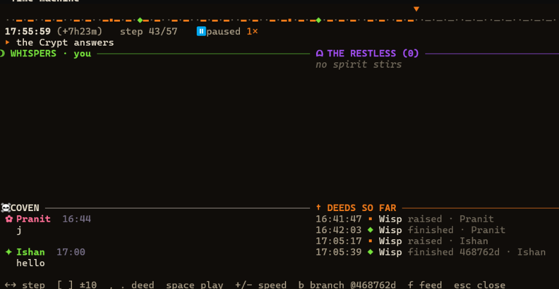
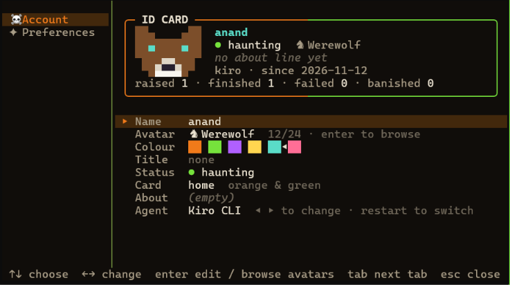

# selecle

A haunted terminal workspace where you and your friends build together with AI "spirits".
Talk to the Crypt (the common agent), it raises spirits to change your project, and every
spirit's work is merged through git.

Built for the Kiroween hackathon (Frankenstein track): a hand-written RFC 854 Telnet server,
git as the database, pixel-art terminal UI and headless [Kiro CLI](https://kiro.dev/cli) agents,
stitched into one zero-dependency Node app.



| | |
|---|---|
|  |  |
| Ask the Crypt; it raises a spirit, and the work is sealed into git | A built-in guide shows you around |
|  |  |
| Friends join one project from any terminal | `/replay`: step through every spirit's deed, branch from any point |
|  | |
| `/settings`: pixel avatar ID card, running on Kiro CLI | |

## Quick start

```
npm install -g selecle-cli     # Node 18 or newer
kiro-cli login                 # or: selecle login
selecle init                   # optional: makes it a git project + the Kiro kit for your own Kiro
selecle                        # in any project folder
```

No Kiro CLI yet? selecle's tools page installs it (or: `irm https://cli.kiro.dev/install.ps1 | iex`
on Windows, `curl -fsSL https://cli.kiro.dev/install | bash` on macOS and Linux). To look around
without an account, run `selecle --mock` for free pretend agents.

## Kiro inside

selecle is a multiplayer front end for Kiro's way of working:

- **Specs first, then spirits.** Ask the Crypt for a feature ("add a dark mode toggle") and it
  doesn't start coding. The **Scribe**, a Kiro agent that can only write in `.kiro/specs/`,
  writes a proper Kiro spec: `requirements.md` (user stories, EARS acceptance criteria),
  `design.md` and `tasks.md`. The file list opens it, and anyone in the room can read or edit it.
  Say "build it" (or `/spec build <name>`) and spirits build it **one task at a time**, each on
  its own git branch, each merged before the next starts, each ticking its task in `tasks.md`.
- **Spirits are Kiro custom agents with roles.** `selecle-builder` writes code,
  `selecle-tester` may only write tests, `selecle-chronicler` only docs, `selecle-scribe` only
  specs, and `selecle-crypt` has no tools at all. The Crypt picks the role for each job; a
  task line `_Spirit: tester_` picks it for spec tasks. selecle installs these into
  `~/.kiro/agents/`, so `kiro-cli agent list` shows them and you can chat with any of them.
- **The séance: an MCP server for the room.** Every spirit runs alone in its own git worktree,
  but through `selecle mcp` it can still see the room: `room` (who's here, what the other
  spirits are editing right now), `deeds` (who changed this file, and why), `spec` (the
  project's specs and tasks) and `whisper` (ask the humans a question in the team chat). Add it
  to your own Kiro too: `kiro-cli mcp add --name selecle --command selecle --args mcp`.
- **Your steering rules everything.** The Crypt plans with the project's `.kiro/steering/`, and
  every spirit loads it, including steering you haven't committed yet. `/steering` has a spirit
  write `product.md`, `tech.md` and `structure.md` from your code.
- **The Kiro kit: your own Kiro knows the room too.** `selecle init` (or `/init`) adds
  `.kiro/settings/mcp.json` (the séance), `.kiro/steering/selecle.md` and two hooks: when a Kiro
  session starts it learns who's here and what the spirits are doing, and if your Kiro is about to
  write a file a spirit is working on, that write is **paused once** with a warning so you can
  wait or go ahead. Commit `.kiro/` and everyone who opens the project in Kiro gets it.

`/spec` lists the specs and their progress, `/kiro` (or `selecle kiro`) shows the agents,
steering, specs and kit. **Full guide: [docs/kiro.md](docs/kiro.md).** In `--mock` mode the whole spec flow is acted out for free: try
`feature: a dark mode toggle`, then `build dark-mode-toggle`.

## Start

```
selecle
```

The very first time, a welcome page asks for everything your ID card holds (name, avatar, colour, title, status, about, card style) and shows the agent it runs on: **[Kiro CLI](https://kiro.dev/cli)**. The Crypt and every spirit run through `kiro-cli chat --no-interactive` on your own Kiro account (tested with Kiro CLI 3.2.1); sign in with `selecle login` (which runs `kiro-cli login`), or set `KIRO_API_KEY` for headless use. Spirits get only Kiro's file tools (`read`, `write`, `glob`, `grep`) and the séance: no shell, no web, no AWS. selecle reads each spirit's progress from Kiro's `--output-format stream-json` events. You can change your ID card later with `/settings`; `selecle onboard` shows the welcome page again.

Two other agent CLIs (Claude Code and Antigravity CLI) are still supported but hidden. `--agent claude` or `--agent antigravity` uses one for a single run, and `SELECLE_AGENTS=all` shows them in the welcome page, `/settings` and `--help` again. A profile saved with one of them moves to Kiro on the next start and says so once.

Next, a **tools page** checks the programs selecle works with (git, your agent CLI, cloudflared for `/invite public`, a code editor, ssh) and installs the missing ones with one key (winget on Windows, Homebrew on Mac, a download or apt on Linux). It comes back whenever something is missing, unless you choose "don't ask again"; `/tools` or `selecle tools` opens it any time.

After that, it checks you can use it (signed in to your agent, or free pretend agents),
makes sure the folder is a safe git project (or offers a small practice project), then opens
the app with a short guide that shows you around. The guide opens by itself the first time;
`/guide` brings it back, and `selecle guide` prints it as text.

Install it from npm (Node 18 or newer):

```
npm install -g selecle-cli
```

Or from a copy of this repo:

```
npm install
npm link          # puts the selecle command on your PATH (undo: npm unlink -g selecle)
```

## Things to type in the app

| Type | What it does |
|---|---|
| anything | talk to the Crypt |
| `/` | every command and ready-made prompt, pick with arrows, Tab, Enter or click |
| `@` | pick a project file to mention |
| `/summon <task>` | raise a spirit (separate several tasks with `;`) |
| `/feed` | every spirit: who, how it ended, time, cost, files |
| `/replay` | time machine: scrub, play, branch from a sealed moment |
| `/me` | your ID card, 24 animated avatars, title, status |
| `/invite` | open the door for friends: shows the room code (`/invite stop`, `who`, `allow <name>`, `kick <name>`) |
| `/open <file>` | open a project file in a small editor (ctrl+s saves); a new name makes a new file |
| `/open <folder>` | open that folder as the project (made a git project if it is not one) |
| `/run <command>` | run a command in the project and watch its output (`npm test`, `node app.js`) |
| `/code` | open the project in VS Code on your computer (host only) |
| `/pair <join code>` | join a friend's crypt (the code their `/invite` showed) |
| `/pair` | show a code that links another device of yours; `/pair selecle1.<code>` uses one |
| `/sync` | sync the Crypt's memory with your other devices now |
| `/guide` | the quick start |

## Friends

For friends on other networks, type `/invite public`: selecle opens a tunnel and gives you a public `https://` address (through Cloudflare if `cloudflared` is installed, otherwise through localhost.run using the `ssh` you already have). Your friend runs `selecle join https://that-address/ROOMCODE` and needs nothing else. Anyone with the address and the room code can enter, and the address changes every time; `/invite private` closes it. Too many wrong room codes lock the door for a minute.

**Friends in their own code editor.** A friend you have trusted (`/invite trust <name>`) types `/code` and their selecle makes a copy of the project on their computer (`~/selecle-work/<project>`), opens their code editor on it, and keeps it in step: every file they save is sent to the host's project, and what changes on the host comes down to them. If both sides changed the same file, the host's version wins and the friend's is kept in `.selecle-conflicts/`. They need the app (`selecle join`), not a plain Telnet window.

**Everyone on their own AI.** By default friends' spirits run on the host's account. `/invite diffai on` makes friends' spirits run on each friend's own computer with each friend's own agent CLI and subscription; the Crypt itself keeps answering on the host's account (the friend must be trusted and use the app). `/invite diffai off` goes back. `/invite trust everyone` trusts everyone in the crypt, and everyone who joins later, with every permission; `/invite untrust everyone` takes it all back.

**The prompt line** works like a normal one: arrows move inside it, Home and End jump, Ctrl+arrows jump words, Delete and Backspace work on either side, and Up and Down bring back lines you sent. To let friends summon on the host's account instead: `/invite allow <name>` for one person, `/invite summon on` for everyone.

Inside selecle, type `/invite`. It opens the door and shows the join command in a box (it is also copied to your clipboard; `/copy` copies it again). On a GitHub Codespace, or with `SELECLE_PUBLIC_URL` set to an ngrok, Cloudflare or dev-tunnel address, that command is a web address that works from any network with nothing else installed on the friend's side:

```
selecle join https://your-codespace-6666.app.github.dev/ROOMCODE
```

(In a Codespace, set the port to Public once: Ports tab, right-click the port, Port Visibility, Public.) On a local network it is a join code like `selecle://192.168.1.9:6666/BATS42`. A friend already in selecle types `/pair selecle://192.168.1.9:6666/BATS42` and lands in your crypt. From a terminal:

```
selecle join selecle://192.168.1.9:6666/BATS42     # or: selecle join, then the room code; any Telnet client works too
```

(`selecle host` still does the same from a terminal, when you want a server with no screen of its own.)
Guests start with chat-only. `/invite allow <name>` lets one raise spirits on your account. `/invite trust <name>` lets one open, edit and run things in the project on your computer; `/invite untrust <name>` takes it back at once. Only trust people you would hand your keyboard to.

## Another device

The Crypt's memory follows you by itself through your git remote, sealed with a key that never
goes into git. Once per new device:

```
/pair                        # in the app on the old device: shows a pairing code
/pair <code>                 # in the app on the new device, inside a clone of the project
```

(`selecle pair` and `selecle pair <code>` do the same from a terminal.)

## Useful flags

`--mock` free pretend agents · `--real` real agents · `--name <name>` · `selecle --help` for all.

## Tests

```
npm test
```
